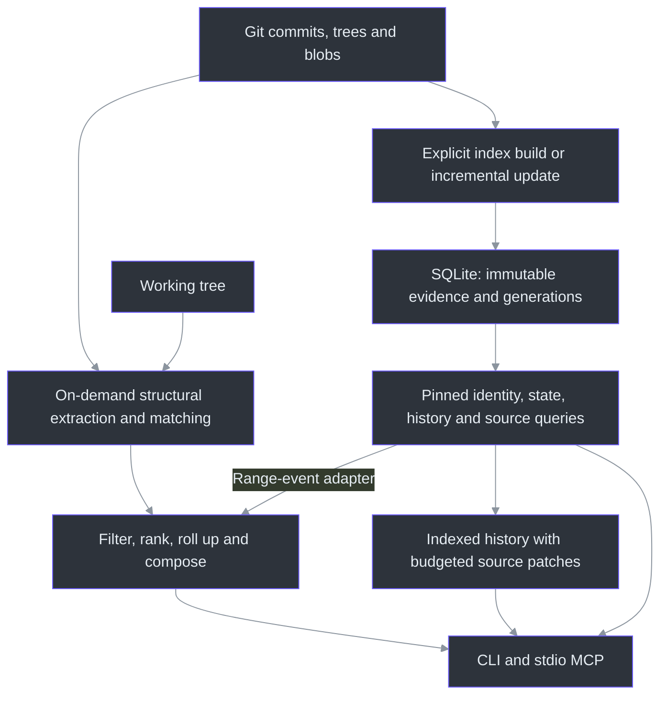
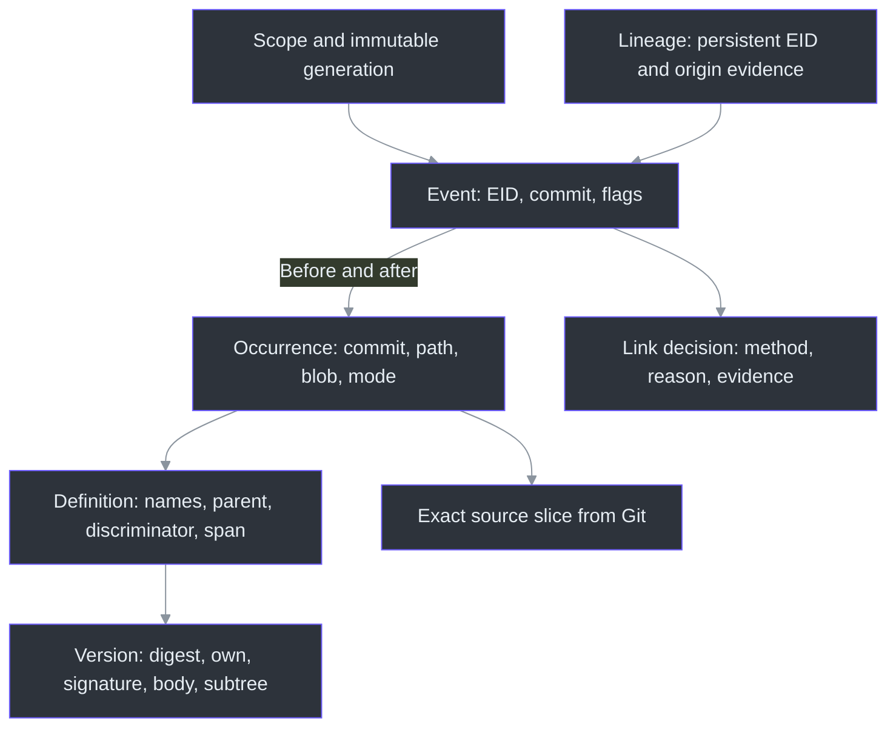

# gita Technical Guide

**Transitional release:** Indexed entity history is now the default. Legacy
structural review, reconstructing Python APIs and browser/evaluation entry
points require strict `GITA_ENABLE_LEGACY=1`; ordinary history remains indexed,
with `--indexed` a compatibility no-op and `--legacy` the explicit old engine.
The two-engine descriptions below explain retained internals, not default
availability. Legacy still ships; parser/matcher policy and storage are unchanged.
The index-first specs remain incomplete, including qualification, query parity,
independent verification and genuine endpoint diff.

**Version:** 1.0.0.
This document describes shipped behavior. F0-F3 are implemented; independent
F4 qualification is not.

## 1. The Problem and the Design

Git records source bytes and commit ancestry. A coding agent often needs a
different unit of information: which function changed, how its interface changed,
where it moved, or what it contained at an earlier revision. Repeatedly reading
file patches and reconstructing those relationships spends context on discovery
before the agent can answer the actual question.

gita supplies named structural changes and reusable entity evidence. It does
not use a language model to summarize code, replace Git's object database, or
prove program behavior. The calling agent still reasons about the evidence.

Two complementary engines are shipped:

| | Structural engine | Indexed foundation |
| --- | --- | --- |
| Input | A pair of revisions, or committed base versus working tree | A published first-parent committed-history scope |
| Identity | Path/name locators, hashes and guarded similarity matching | Policy-qualified persistent EIDs and accepted evidence links |
| Work | Derive a comparison on request | Build/update explicitly; read a pinned generation |
| Main users | Ordinary `diff`, `show`, `expand`, unindexed `history` | `index`, `id`, indexed `history`, state/source/file-entity queries |
| Limitation | Deterministic heuristics can still pair entities incorrectly | Conservative matching can leave ambiguity or gaps; it does not prove semantic equivalence |

The indexed comparison adapter also feeds the structural renderer. In this
snapshot it converts **events throughout a range**, not net endpoint state.
Consequently `diff A B --indexed` is not interchangeable with `diff A B`.

Sources: `diff_revisions` in [revisions.py](../src/gita/revisions.py), matching
in [differ.py](../src/gita/diff/differ.py), `compare` in
[compare.py](../src/gita/index/compare.py), and CLI dispatch in
[cli/__init__.py](../src/gita/cli/__init__.py).

## 2. Architecture



The shared vocabulary is a named entity, but the implementations remain distinct.
`context/` composes structural answers; `index/` owns committed evidence and
lineage; `cli/indexed.py` owns indexed command validation, envelopes and patches;
`mcp/tools.py` adapts those operations without embedding the MCP transport in the
query engine.

Sources: `compose` in [answer.py](../src/gita/context/answer.py), `build` in
[builder.py](../src/gita/index/builder.py), `IndexSession` in
[query.py](../src/gita/index/query.py), [indexed.py](../src/gita/cli/indexed.py)
and [tools.py](../src/gita/mcp/tools.py).

## 3. What an Entity Contains

An indexed entity is represented by linked records, not a single mutable row
containing its name, body and all of its history.

| Record | Stored information | Why it is separate |
| --- | --- | --- |
| `EntityVersion` | Parse fingerprint, language, kind, source digest; normalized `own`, `signature`, `body`, `subtree` representations | Content evidence is independent of commit and path. `None` means unavailable, not empty. |
| `EntityDefinition` | Version/parse IDs, literal name components, kind, parent definition, discriminator, byte and line span | Names, containment and position belong to a particular parse. |
| `EntityOccurrence` | Definition ID, commit OID, raw path bytes, blob OID, object type, mode | Identifies the definition in an exact committed Git tree entry. |
| `LineageSeed` | Identity context, seed commit, occurrence, reason and observation evidence where required | Creates a policy-qualified persistent EID; separates proven genesis from observation. |
| `LineageLink` | Parent/commit edge, source/destination occurrences, decision status, method, reason and evidence | Records why a continuation was accepted, rejected or left uncertain. |
| `ChangeEvent` | EID, commit/parent, optional before/after occurrences, independent flags and decision reference | Preserves what happened at each transition, rather than only the final state. |

`own` represents the entity's own normalized structure; `subtree` includes its
nested structure. Separate signature/body evidence supports finer change
classification. These are parser-derived representations, not embeddings,
natural-language explanations, resolved types or a call graph.



`SourceSpan` uses half-open original byte bounds and inclusive one-based display
lines. Source retrieval validates the occurrence, its membership and digest,
then slices the original committed blob. It does not read current worktree text.

Canonical content-addressed record IDs use domain-separated BLAKE2b-256 and full
evidence checks. `eid1_` denotes sufficient genesis evidence; `oeid1_` denotes an
observed/uncertain origin. An `observed` event at a bounded anchor must not be
described as the function's birth. Scope names and local generation identifiers
select publications; they are not substitutes for entity identity.

A locator such as `security.py::TokenValidator::check` is human-readable and can
change. A persistent EID continues across a supported rename/move **within the
recorded identity context**. Different policies or boundaries can produce
different identities; an EID is not a universal cross-index semantic identifier.

Sources: the record classes and `SourceSpan` in
[model.py](../src/gita/index/model.py), `parse_evidence` in
[evidence.py](../src/gita/index/evidence.py), and `IndexSession.source` in
[query.py](../src/gita/index/query.py).

## 4. Foundation Layers

### F0: Contracts Before Queries

The immutable records define what an answer can claim: exact content, location,
identity, a transition or incomplete evidence. Canonical encoding retains Git
object format and raw paths. `IdentityContext` pins anchor, boundary, parser and
matcher fingerprints, and deterministic limits. This prevents an answer from
silently mixing incompatible interpretations.

Source: [model.py](../src/gita/index/model.py).

### F1: Evidence, Storage and Publication

Committed access uses local Git objects, with replacements/lazy fetching disabled
and unsupported ancestry interpretations rejected. Parsing runs in isolated
workers with per-file deadlines. A failed or unsupported parse cannot become
a confidently empty population of definitions.

SQLite schema v2 stores evidence and interpretation separately from generation
membership, bindings, events, departures and coverage. Transactions publish a
generation only after checks; failure rolls back the build. Pinned read snapshots
keep a consistent view while another writer publishes an update. Explicit
collection protects active publications and retained references.

Storage lives at `<git-common-dir>/gita/index.sqlite`, so linked worktrees share
the store. Named scopes separate selected histories. Old schemas are refused
and preserved; `--rebuild` is not a physical database migration.

Sources: `CommittedRepo` in [git.py](../src/gita/vcs/git.py),
[worker.py](../src/gita/index/worker.py), `IndexStore` in
[store.py](../src/gita/index/store.py), and [schema.py](../src/gita/index/schema.py).

### F2: Strict Lineage and Independent Events

The builder considers before/after populations, including unchanged files,
before accepting continuity. Established bindings carry forward; supported
same-location edits and exact-evidence relocations can continue an EID.
Copy/swap guards prevent a retained copy from taking the original identity.
Repeated-name siblings require distinctive evidence, not ordinal pairing or
matching the last two leftovers.

Similarity can produce a candidate, but **does not establish accepted indexed
identity**. Insufficient evidence remains ambiguous or unknown. Deletion followed
by a later reintroduction gets a new identity. First-parent merge processing
does not import a side branch's independent lineage history.

Once continuity is accepted, classification records independent flags such as
`renamed`, `moved`, `signature_changed`, `body_changed`, `own_content_changed`,
`descendant_changed`, `cosmetic` or `mode_changed`. An event can carry more than
one flag. Additions, removals, observations and gaps remain distinguishable.

Sources: matching decisions in [builder.py](../src/gita/index/builder.py),
`match_manifest` and `classify_transition` in
[matching.py](../src/gita/index/matching.py), and `ChangeEvent` in
[model.py](../src/gita/index/model.py).

### F3: Incremental Builds and Reusable Reads

An initial build pins a tip and walks its first-parent history to the selected
anchor. An update with compatible policy walks only the new suffix and reuses
persisted prefix evidence. Same tip and compatible settings return the existing
generation without parsing. A changed boundary, policy, shortened timeline or
divergent history requires explicit rebuild rather than silent reinterpretation.

`open_index` opens a published generation read-only. `resolve`, `state_at`,
`history`, `events_in`, `entities_in` and `source` operate on that pinned view.
Reads never build or reparse missing evidence. Cursors bind scope, generation,
query, revision, order and position; they cannot silently follow a new publication.

Parser workers default to up to four CPUs, with a supported range of 1-32 and a
default five-second per-file timeout. These are operational controls, not claims
about whole-build duration or total memory bounds.

Sources: `build` in [builder.py](../src/gita/index/builder.py), `IndexSession` in
[query.py](../src/gita/index/query.py), validation in
[indexed.py](../src/gita/cli/indexed.py).

## 5. Tools Built on These Paths

### Structural Review: Diff, Expand and Show

```bash
gita diff HEAD~1 HEAD
gita diff HEAD~1 HEAD --filter TokenValidator
gita diff HEAD~1 HEAD --intent "review token validation"
gita diff HEAD~1 HEAD --interface-only --brief
gita expand security.py::TokenValidator HEAD~1 HEAD
gita show security.py::TokenValidator::check HEAD~1 HEAD
```

Names above are illustrative; use locators returned by a real diff.
`diff` provides a headline, compact entity listing and useful hunks when they fit.
`expand` names changed descendants of a rolled-up container. `show` retrieves
entity-specific hunks. Expanding is optional, not a mandatory extra call after
an already complete diff.

The structural path extracts and matches entities, removes classified noise,
filters, ranks and composes the answer. Rollups group nested entities, repeated
changes and bulk tests. Intent ranking uses deterministic lexical evidence from
names, containers, paths and signatures; it reorders, not filters. It neither
infers user intent nor supplies a semantic relevance guarantee.

`--filter` selects name/path matches. `--interface-only` selects potential
interface changes, not proven downstream breakage. `--patch` emits material
hunks; `--brief` omits them. Triple-dot CLI syntax uses a merge base. Bare CLI
`diff` inspects uncommitted work, whereas `show` and `expand` default to
`HEAD^`/`HEAD`: pass explicit revisions for a consistent investigation.

Sources: [cli/__init__.py](../src/gita/cli/__init__.py), `compose` in
[answer.py](../src/gita/context/answer.py), [rollup.py](../src/gita/context/rollup.py),
[rank.py](../src/gita/context/rank.py), [patch.py](../src/gita/context/patch.py).

### Unified History: One Entity or a Commit Range

| Invocation | Answer |
| --- | --- |
| `history MyFunction` | Unindexed per-commit function changes, with patches when they fit. |
| `history A B` | Unindexed commit summaries of entity changes throughout a range. |
| `history MyFunction --indexed` | Events along one persistent identity, with exact-source patches by default. |
| `history A B --indexed` | All indexed entity events in `(A, B]`, oldest first, including intermediate changes. |
| `history MyFunction --indexed --brief` | Metadata only, without historical source reads. |

One positional token always means an entity. With two tokens, a first token that
resolves as a Git revision selects range mode; otherwise the legacy
`entity since` form remains supported. For an entity name that also matches a
ref, use explicit `--since`/`--until` flags to avoid ambiguity. Indexed entity
history uses `--at`, not legacy revision flags; `--order` defaults to newest.
Both modes accept `--limit`, default 20. In legacy history the limit bounds the
commit search; in indexed history it bounds a page of results.

Unindexed history is a derived timeline, not a persistent rename-following
guarantee, and may report an edit both on a branch commit and its merge. Indexed
history is constrained to the published first-parent membership. Equal indexed
range endpoints return no events; reversed or out-of-scope ranges are errors.
There is no separate `events` or `evolution` CLI command at this baseline.

Sources: `entity_history` and `series` in [history.py](../src/gita/history.py),
`_normalize_history_arguments` in [cli/__init__.py](../src/gita/cli/__init__.py),
`_queries` in [indexed.py](../src/gita/cli/indexed.py), and
`IndexSession.history/events_in` in [query.py](../src/gita/index/query.py).

### Index, Identity and Exact Source

```bash
gita index --scope review
gita id MyFunction --scope review
gita id OldFunctionName --historical --scope review
gita history MyFunction --indexed --scope review --order oldest
gita history HEAD~1 HEAD --indexed --scope review --json
gita index --status --scope review
```

Choose a returned full EID when a name is ambiguous. `state_at` distinguishes
present, removed, absent and unknown; outside-scope is an error. `entities_in`
enumerates occurrences in a file. `source` retrieves an occurrence's exact bytes.
These three are available through Python and MCP, not separate CLI subcommands.

Indexed entity/range patches use the event's stored source/destination within
the same session. Metadata pagination happens first; only complete patches that
fit the remaining serialized budget are included. `patch_status` is:

| Status | Meaning |
| --- | --- |
| `included` | A unified `patch` is present, with absolute file hunk lines. |
| `unchanged` | Source bytes are identical, as in a pure move. |
| `not_applicable` | No proven before/after transition, as at an observed anchor. |
| `omitted_budget` | Retrieve the retained occurrences or retry with more budget. |
| `unavailable:source_unavailable` | Committed bytes cannot be supplied/validated. |
| `unavailable:non_utf8_source` | A lossless UTF-8 text patch cannot be supplied. |

`--brief` omits patch fields and source reads. Review hunks describe extracted
byte spans, not necessarily a standalone whole-file patch. Source retrieval over
MCP instead returns complete UTF-8 text or base64, with encoding and byte count;
it errors rather than silently truncating the source.

Sources: `_event_patch`, `_history_patches`, `_emit_page` in
[indexed.py](../src/gita/cli/indexed.py), `source_tool` in
[tools.py](../src/gita/mcp/tools.py), [query.py](../src/gita/index/query.py).

## 6. Agent Workflow and MCP Surface

For review, start with `diff` and drill only where necessary. For evolution,
explicitly build a scope, resolve identity, inspect history/state, then request
source only if the inline evidence is insufficient. Carry the same scope,
generation and occurrence references across calls.

The stdio server is started with `gita serve` and the optional `mcp` dependency.
The MCP library supports SDK 1.x and 2.x imports. Every tool accepts `repo`; absent
an override it uses the configured server root. `GITA_REPO` is supported by the
server builder's default-root path; CLI `serve` passes its `-C`/current directory.

| MCP tool | Important inputs and behavior |
| --- | --- |
| `gita_diff` | `base`, `head`, `budget`, `filter`, `interface_only`, `brief`, `intent`, `patch`, `indexed`, `scope`, `generation`. Defaults to `HEAD^`/`HEAD`. Use `base="HEAD", head=null` for uncommitted work. |
| `gita_expand` | `entity`, revisions, `budget`, `intent`. Returns changed descendant names. |
| `gita_show` | `entity`, revisions. Returns hunks; no tool-level budget argument. |
| `gita_history` | `entity` or `base`/`head`; optional `indexed`, `scope`, `generation`, `at`, `order`, `limit`, `cursor`, `brief`, `budget`. |
| `gita_id` | Entity/name/locator, `historical`, `at`, scope/generation, limit/cursor/budget. Ambiguity remains explicit. |
| `gita_index` | `action` defaults to `status`; explicit `build`, `gc`, `verify`. Build supports ref/boundary/rebuild/workers/timeout; GC requires a generation. |
| `gita_state` | Full `eid`, optional revision, scope/generation and budget. |
| `gita_source` | Complete returned `occurrence`, its scope, optional generation and budget. Never current worktree text. |
| `gita_entities` | Repository-relative `path`, optional revision, scope/generation, limit/cursor/budget. |

Index build/GC modifies local index storage, not Git source or commits. Read-only
queries never initialize a missing index. `verify` exposes an unavailable status,
not a completed independent verification. The MCP surface covers code-context
operations; evaluation/dashboard modules are not MCP tools.

Sources: tool registrations and instructions in [server.py](../src/gita/mcp/server.py),
adapters in [tools.py](../src/gita/mcp/tools.py), packaging in
[pyproject.toml](../pyproject.toml).

## 7. Budgets, Coverage and Failure Contracts

The structural composer measures its answer text and, when a nonempty raw diff
is available, caps that text against the raw diff's token count. This is not a
universal promise for every transport: diff JSON adds structured metadata,
coverage warnings can be appended, `show` is unbudgeted, and patch-only output
does not expose the same completeness envelope. Do not present a per-answer
cap as proof of lower session cost.

Indexed CLI JSON budgeting counts the serialized envelope, metadata, cursor and
included patches. A page reports shown/total/omitted event counts; omitted patch
status is separate. A too-small budget produces a typed failure, or a short stderr
diagnostic when even the error envelope cannot fit. MCP protocol overhead is not
the same thing as the adapter's serialized content budget.

Coverage distinguishes nonindexed/unsupported files from gaps that can compromise
lineage interpretation. `partial` does not mean every reported identity is wrong,
and successful status does not prove exhaustive coverage. Source availability may
remain unchecked until a source request; an unknown field must not become a claim
that no source or entity exists.

For indexed CLI commands, exits are: 0 success (possibly partial); 1 missing,
not-live or ambiguous identity; 2 invalid selection/options/cursor; 3 unavailable
or incompatible generation/verifier; 4 resource or source-access failure;
5 corruption/contract failure; 6 insufficient budget. Legacy command exit
behavior is separate. Consumers should inspect structured status and errors.

Sources: [answer.py](../src/gita/context/answer.py), [indexed.py](../src/gita/cli/indexed.py),
`_coverage` in [query.py](../src/gita/index/query.py),
[compare.py](../src/gita/index/compare.py).

## 8. Verification and What Counts as a Win

The repository contains CLI, MCP, extractor, lineage, storage, source, pagination
and failure-path tests. These test implementations; passing them is not independent
qualification of arbitrary real-world refactors. F4 and `index --verify` remain
unavailable in this version.

The paired evaluation harness compares agent runs using native usage records,
blinded reference-issue matching and repository-cluster bootstrap intervals.
The older harness retains keyword-recall scoring for compatibility; that proxy
is not used in the paired study. Neither harness proves general task correctness.
See the [evaluation guide](../evals/README.md) and
[historical results summary](../evals/RESULTS.md); the study is not validation of
the current release.

A defensible win is a correct, evidence-backed answer with less total investigation
cost: useful information retained, fewer unnecessary reads or turns, and no hidden
coverage loss. Report end-to-end tokens and cached/fresh usage, latency, answer
quality, and index build/update/storage costs. Measure cold builds separately from
repeated queries. A small tool response that causes more follow-up calls is not
automatically a win. Milestone descriptions are not ablation results.

Sources: [tests/test_cli.py](../tests/test_cli.py), [tests/test_mcp.py](../tests/test_mcp.py),
[tests/test_index_query.py](../tests/test_index_query.py), scoring in
[score.py](../src/gita/eval/score.py), [runner.py](../src/gita/eval/runner.py),
[events.py](../src/gita/telemetry/events.py), [verify/README.md](../verify/README.md).

## 9. Scope and Further Reading

Indexed adapters: Python, JavaScript, TypeScript/TSX, C#, C/C++, Go, Rust, Swift,
PHP, Java, Kotlin, Ruby, Bash, PowerShell, Dart, HCL/Terraform, Markdown,
JSON, YAML and TOML. SQL and CUDA are not indexed. Notebooks and Go templates
are not implicitly covered by their embedded Python/Go languages.
These are structural parsers, without compiler invocation, macro expansion or semantic linking of
declarations and definitions. Consult [languages.py](../src/gita/entities/languages.py),
[evidence.py](../src/gita/index/evidence.py) and [FOUNDATION.md](FOUNDATION.md).

Dart signature/body siblings are projected into one byte-preserving callable;
the header alone is never represented as the complete implementation.
Unrecognized Dart members remain in enclosing source. Swift multi-binding
properties remain enclosed, and multiple unbraced PHP namespaces are explicit
unsupported layouts. HCL moves retain the same conservative minimum-body/copy
guards as other indexed identities. `GITA_PARSER_CACHE` selects an explicit
absolute native-cache location consistently across CLI, MCP and workers;
cache paths do not become entity identity. Grammar artifacts and extraction
rules remain part of the parse fingerprint.

There is no shipped caller graph, impact/test selection, automatic conflict
resolution, entity-linked memory, complete handoff orchestration or on-device
model integration. The long-term review/trace/compare/handoff vision should not
be presented as a completed product workflow.

- Setup and command walkthrough: [QUICKSTART.md](QUICKSTART.md).
- Foundation contracts and storage details: [FOUNDATION.md](FOUNDATION.md).
- Evaluation harness and methodology: [evals/README.md](../evals/README.md).
- Release notes: [CHANGELOG.md](../CHANGELOG.md).