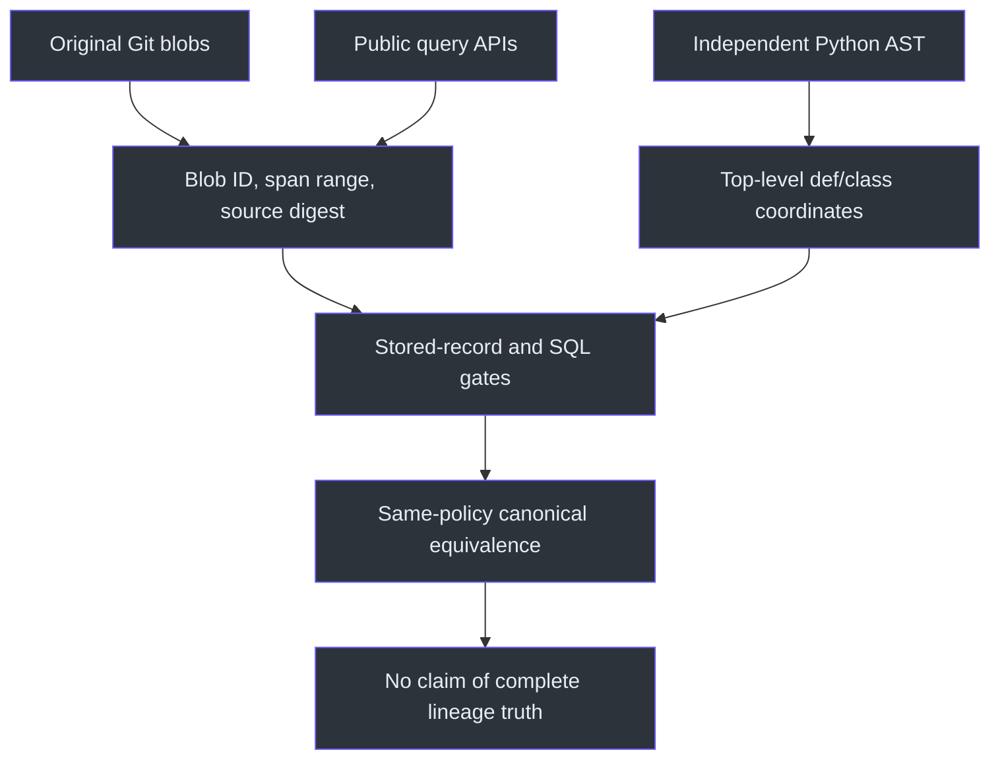

# Public-repository indexing observations — 2026-10-14

## Scope and evidence

These observations exercise real public Git objects rather than an authored
lineage fixture. They are absolute measurements of candidate
`b64d43fbe8f57d6ce920aca059ef3de061bf59d1`, **not a baseline speedup claim**.
The baseline `a99434e` was not benchmarked here. The
[manifest](../../verify/results/public-20261014.manifest.json) pins each public
tip; [machine-readable observations](../../verify/results/public-20261014.json)
retain every attempted scenario, including harness failures and deadline stops.
No repository source, dependency tree, or SQLite index is checked in.

**History is bounded, not full history.** For each corpus, the oldest member of
the last 21 first-parent commits is the explicit anchor. The history build
indexes the first 20 members; append adds the last real commit. Cold-final
indexes all 21 members from exactly the same anchor. Snapshot uses only the
pinned tip, with `since=tip`. The downloaded repositories are shallow and their
available commit counts must not be confused with upstream total history.
The supervisor enforces these scopes independently against SQL membership.
([`bench_public_index.py:scope`](../../verify/bench_public_index.py);
[`public_index_worker.py:verify_sources`](../../verify/public_index_worker.py);
[`builder.py:build`](../../src/gita/index/builder.py))

## Execution architecture


Provisioning, Git directory copies, and parser availability checks happen before
the measured operation. Corpus Python/JavaScript/Rust code is never executed or
imported. The process imports only the pinned gita runtime and verification
tooling. There are no corpus dependency installs, model calls, or global cache
flushes. Each cold scenario has a new SQLite database; append/no-op/query
deliberately reuse the history publication. OS/Git cache warmth is uncontrolled.
([`public_index_worker.py:run`](../../verify/public_index_worker.py);
[`bench_public_index.py:main`](../../verify/bench_public_index.py))

The campaign uses four parser workers, a 150-second per-attempt deadline, and
a 900-second initial campaign deadline. Every requested scenario still produces
an attempt if the campaign budget is depleted; its deadline shrinks to the
remaining budget. Index storage is capped at 256 MiB per database. Production
parser bounds remain 5 MiB/blob, 50,000 definitions, 32 MiB representation;
matching remains 64 candidates and 10,000 pairs. No copy guard or full-population
matching check is removed. A serial history run changes workers only.
([`manifest`](../../verify/results/public-20261014.manifest.json);
[`builder.py:BuildLimits`](../../src/gita/index/builder.py))

## Correctness interpretation



The real-corpus checks are deliberately separate:

* For each sampled member/path, independent `git ls-tree -r -z` inventory binds
  the stored blob, mode and object type to that exact commit and raw Git path.
  This catches internally consistent stale intervals, including at intermediate
  history members, before loading the blob. Git object IDs and BLAKE2b source-span
  digests are then checked against original
  blob bytes, for up to eight non-module definitions at **every indexed member**.
* Python AST supplies independent UTF-8 byte coordinates for top-level
  functions/classes in up to eight indexed Python files at the tip. Decorators
  are excluded: the evidence contract represents the def/class node, not its
  decorated wrapper.
* SQLite integrity and foreign keys, stored immutable record contracts, and
  exact bounded membership are checked separately.
* Representative `entities_in`, `state_at`, and `history` answers must remain
  stable across five calls each. `source` bytes are compared with Git slices;
  these checks do not establish that history links are semantically true.
* Serial/parallel and append/cold-final canonical comparisons retain immutable
  records/EIDs/contexts, excluding only allocation and generation attachment
  fields documented in `canonical_digest`.

The real repositories have **no authored entity operation ledger**. Matching
equivalence is not independent lineage truth. This is not full F4, inventory
completeness, all-entity span coverage, or release qualification. Two additional
hand-reviewed JS/Rust snapshot spans are pinned in the
[span manifest](../../verify/results/public-20261014.spans.json) and independently
checked by [`verify_public_spans.py:verify`](../../verify/verify_public_spans.py).
They cover Express `lib/express.js:createApplication` (bytes 660–1227) and
ripgrep `crates/core/main.rs:main` (bytes 1530–2575), not either language's complete
definition population. Sampled source digests alone are not a parser oracle.
([`public_index_worker.py:source_check,ast_spans,verify_sources`](../../verify/public_index_worker.py);
[`index_oracle.py:validate_records,canonical_digest`](../../verify/index_oracle.py);
[`query.py:IndexSession`](../../src/gita/index/query.py);
[`store.py:IndexStore`](../../src/gita/index/store.py))

## Measurement conventions

`operation_seconds` covers only the production `build` call; publication and
correctness must both succeed before `completed_seconds` is populated. Failed
verification retains the raw operation time but is not a completed-build sample.
Query records separate session-open time from five warm API samples per method.
The supervisor samples RSS and CPU for its child process tree every 50 ms,
including build/read **and verification**, not exclusively parser or builder
execution. CPU is a lower bound; short-lived Git processes and transients can
be missed. Shared RSS pages are counted once per process. Main/WAL peaks are
sampled separately; anonymous SQLite TEMP storage is unavailable (`null`), not
zero. Returned database bytes are measured after handles close.
([`public_index_worker.py:run`](../../verify/public_index_worker.py);
[`bench_public_index.py:execute`](../../verify/bench_public_index.py))

Power, contention and OS caches are uncontrolled on a shared Windows host.
Single observations and failed-attempt retries cannot support statistical
speedup, median/percentile, scalability, or reference-machine claims.

## Reproduction

Use a clean checkout/worktree of the candidate source SHA plus the verification
files in this change. Install gita's existing benchmark dependencies in an
isolated environment during setup, not during measurement. In PowerShell from
that checkout:

```powershell
$Python = ".\.venv\Scripts\python.exe"
$Corpus = "..\public-index-corpus"
$Output = "..\public-index-observations"
$Manifest = "verify\results\public-20261014.manifest.json"
$Pins = Get-Content $Manifest -Raw | ConvertFrom-Json
$Urls = @{
  flask = "https://github.com/pallets/flask.git"
  express = "https://github.com/expressjs/express.git"
  ripgrep = "https://github.com/BurntSushi/ripgrep.git"
}
foreach ($Pin in $Pins.repositories) {
  $Repo = Join-Path $Corpus $Pin.name
  git init -q $Repo
  git -C $Repo remote add origin $Urls[$Pin.name]
  git -c core.hooksPath=NUL -C $Repo fetch --no-tags --depth=80 origin $Pin.tip
  git -C $Repo update-ref refs/heads/benchmark $Pin.tip
  git -C $Repo symbolic-ref HEAD refs/heads/benchmark
}
$env:PYTHONPATH = (Join-Path (Get-Location) "src")
& $Python -c "from tree_sitter_language_pack import get_parser; [get_parser(x) for x in ('python','javascript','rust')]"
& $Python verify\bench_public_index.py --manifest $Manifest --source src `
  --corpus-root $Corpus --output $Output
& $Python verify\verify_public_spans.py `
  --goldens verify\results\public-20261014.spans.json --corpus-root $Corpus `
  --run $Output --output "..\public-index-golden-receipt.json"
& $Python verify\export_public_index.py --run $Output `
  --golden-receipt "..\public-index-golden-receipt.json" `
  --output "..\public-index-sanitized.json"
& $Python -m pytest tests\test_public_index_benchmark.py -q
```

The parser preflight explicitly uses `get_parser`, not merely the language-pack
`download` API. The recorded run used tree-sitter 0.26.0 and language-pack 1.14.3;
all three grammars were confirmed available before timing. Subsequent runs
should compare package versions, parser/matcher fingerprints and runtime source
digest with the observations, not assume that the same SHA implies the same
installed grammar binaries.

The output directory must be new and outside the candidate checkout. Inspect
`summary.json` and individual receipts; do not publish request JSON, stderr logs,
repository copies, or databases, which can contain local paths. A nonzero exit
code intentionally preserves failure evidence. Initial download here used
`clone --depth=80 --single-branch --no-checkout` over the approved HTTPS URLs;
the recipe above fetches the exact published pins instead of a future branch
tip. Neither recipe checks out or runs corpus code.

## Results

See the checked-in data for complete per-attempt times, resource samples,
coverage categories, source counters, source pins, licensing digests, and
Git-unchanged receipts. The final table and failed-attempt analysis below are
derived from those receipts, not from generated benchmark claims.

**Strengthened correctness recheck (verification only):** the original timings
and all 28 attempt records predate the independent commit/path tree-entry binding
above and remain unchanged. After review found that an internally consistent
stale interval could otherwise pass blob/digest checks, the gate was strengthened
and all **15 retained PASS publications were rechecked successfully**, including
the retained 20-member predecessors in stores subsequently advanced to 21
members. The separate
[correctness receipt](../../verify/results/public-20261014.correctness-recheck.json)
pins the new worker/supervisor/export/recheck tooling hashes and records
sampled tree-entry, byte/digest, AST and SQL checks. Retained Git and database
bytes were unchanged. This was not a new indexing or latency campaign and does
not make the original timings measurements of the new verification gate.
The CLI now also exits nonzero on canonical equivalence disagreement; the
export sanitizer covers Unix absolute paths as well as Windows/UNC paths while
preserving HTTP(S) URLs and repo-relative evidence paths.

To reproduce only this strengthened check on retained output:

```powershell
& $Python verify\recheck_public_index.py `
  --report verify\results\public-20261014.json `
  --run "..\public-index-observations-20261014-attempt1" `
  --run "..\public-index-observations-20261014-flask-retry" `
  --output "..\public-index-correctness-recheck.json"
```

The two `--run` values are retained campaign roots in original campaign order;
use the locations of your own output directories. The runner never builds an
index. Missing stores or mismatched runtime/parser pins are explicitly
`not_rechecked`/`provisional`, rather than replaced with invented checks.

### Corpus pins

All licenses below were read at the pinned tip; the data contains license-file
SHA-256 hashes, not copied license text. The available commit counts are actual
local shallow-clone counts (`rev-list --count --all`). Full upstream commit
counts were not retrieved.

| Corpus | Pinned snapshot / append tip | Explicit anchor | 20-member history tip | Available commits / tip tree entries | License |
|---|---|---|---|---:|---|
| pallets/flask | `d086db856be187255b8ec61ef409357393020f32` | `258d68b6ff5e2244386540f48b48bab90d6ab827` | `329c32b916938d33fec41f40eb7ed854bf0b3e2b` | 223 / 236 | BSD-3-Clause, `LICENSE.txt` |
| expressjs/express | `a419aa7350389a275ab45fde2e849ed1f02449ef` | `91d333b4cfea158c9798d32e6665d36bd8e37c3d` | `6d2df035a95f3d1002be3e29997b7a4bfe976b5f` | 80 / 214 | MIT, `LICENSE` |
| BurntSushi/ripgrep | `3fce3b5bb0236da2df6d99672afb8a719642eca7` | `626b8951acbced7ff710f4e01624a05f219eec38` | `5055264ae021b5d0e01e55f723622d638ea877f0` | 80 / 237 | MIT OR Unlicense, `COPYING` |

### Machine and actual build observations

Observed environment: Python 3.11.9, SQLite 3.45.1, Git 2.55.0.windows.5,
Windows build 26100, AMD64 Family 25 Model 1, 8 physical/16 logical CPUs,
68,665,831,424 bytes RAM. Runtime-source SHA-256 is
`266264a80e15f792087a875315bbbf6f84e0b2e9c487d8c4f04631a5dcb0639e`.
The runtime source was clean at `b64d43f`; benchmark tooling was uncommitted,
with initial/retry/final tooling hashes retained in the data.

Each successful cell below is **one gated observation**, not an average.
Flask uses the corrected-oracle retry; its failed initial observations remain in
campaign 1. RSS is the whole supervised child-tree sampled peak, including
verification. Database sizes are after close; sampled main/WAL peaks are
separately available in the JSON.

| Corpus | Scenario / members | Build seconds | Tree RSS peak MiB | Database MiB | Outcome |
|---|---|---:|---:|---:|---|
| Flask | Cold snapshot / 1 | 9.595 | 275.44 | 24.86 | Published partial; stated gates passed |
| Flask | Cold bounded history / 20 | 64.028 | 368.83 | 59.21 | Published partial; stated gates passed |
| Flask | Append / 20 → 21 | 12.426 | 210.18 | 64.22 | Published partial; stated gates passed |
| Flask | No-op / 21 | 0.376 | 135.92 | 64.22 | Publication unchanged; zero parse/cache counts |
| Flask | Serial cold bounded history / 20 | 66.473 | 248.04 | 59.21 | Canonically equal to four-worker history |
| Flask | Cold-final / 21 | 65.196 | 358.14 | 59.95 | Canonically equal to append |
| Express | Cold snapshot / 1 | 12.677 | 328.60 | 44.16 | Published partial; stated gates passed |
| Express | Cold bounded history / 20 | 50.856 | 396.29 | 71.09 | Published partial; stated gates passed |
| Express | Append / 20 → 21 | 14.331 | 245.26 | 76.20 | Published partial; stated gates passed |
| Express | No-op / 21 | 0.323 | 125.92 | 76.20 | Publication unchanged; zero parse/cache counts |
| Express | Serial cold bounded history / 20 | 54.724 | 296.13 | 71.09 | Canonically equal to four-worker history |
| Express | Cold-final / 21 | 56.152 | 396.90 | 72.93 | Canonically equal to append |
| ripgrep | Cold snapshot / 1 | 20.144 | 405.50 | 67.82 | Published partial; stated gates passed |
| ripgrep | Cold bounded history / 20 | — | See failed receipt | — | Production contract error; no publication |

Cold-final/append database size differences do not contradict logical equality:
append retains operational predecessor generation rows; the documented
canonical comparison intentionally excludes generation/allocation IDs and
only compares active attachment tables for the selected publication.
([`index_oracle.py:canonical_digest`](../../verify/index_oracle.py))

### Representative read/source observations

| Corpus | Session open seconds | Five `entities_in` calls, ms range | Five `state_at` calls, ms range | Five `history` calls, ms range | Exact API source checks |
|---|---:|---:|---:|---:|---:|
| Flask | 0.181 | 2.91–12.29 | 1.34–3.96 | 6.46–19.53 | 8 |
| Express | 0.167 | 4.41–10.39 | 1.11–3.28 | 9.38–33.11 | 8 |
| ripgrep | — | — | — | — | No bounded-history publication available |

These are observed ranges of five calls in one process, not latency percentiles
or CLI costs. Read scenarios additionally repeat the SQL/record/source gate:
168 sampled byte/digest checks over 21 members. Flask checks 15 independent
top-level Python AST spans at the tip, drawn from the first eight indexed Python
files. Snapshot byte checks cover only eight definitions. History has 160
sampled checks over 20 members. Only the sampled entities are source-verified.

### Actual coverage gaps

All successful builds report `partial`; this report does not reclassify them
as complete because their limited verification gates passed.

| Publication | Complete parse-result rows | Unsupported-language parse-result rows | Additional coverage |
|---|---:|---:|---|
| Flask snapshot | 104 | 132 | Unsupported-language exclusions |
| Flask 20-member history | 150 | 148 | 7 matching candidate-limit records; 2,492 unchecked-cached-source records |
| Flask appended 21-member history | 151 | 148 | 7 matching candidate-limit records; 2,624 unchecked-cached-source records |
| Express snapshot | 153 | 61 | Unsupported-language exclusions |
| Express 20-member history | 184 | 61 | 5 matching candidate-limit records; 1,159 unchecked-cached-source records |
| Express appended 21-member history | 184 | 61 | 6 matching candidate-limit records; 1,224 unchecked-cached-source records |
| ripgrep snapshot | 152 | 84 | One non-source-object extraction record |

Parse-result counts are distinct cached results, **not file counts at every
member**. Coverage records accumulate by member: for example, Flask appended
history has 2,772 unsupported-language extraction records. `omitted=null`
means an unknown omission count, not zero. Matching candidate-limit records
are retained at the unchanged 64/10,000 limits; they are not evidence that all
other candidate links are correct. Sampled byte/source checks do not clear the
index's `unchecked_cached_source` coverage records.

### Failures, retries, and limitations

The initial three-corpus campaign took **776.189 seconds**, under the
900-second execution cap. It retained 21 attempts. A corrected-oracle Flask
campaign took **310.990 seconds** and retained seven more attempts.
Across the 28 real scenario attempts: **15 passed their stated gates and 13
failed**. No real-corpus attempt timed out or exhausted the 256 MiB index cap.
The focused tests separately exercise timeout/crash receipts and tree cleanup.

* **Seven initial Flask verification failures:** the first independent AST
  oracle included decorator wrappers, while indexed spans start at the
  def/class node. Actual Git inspection identified this coordinate mismatch.
  Only benchmark oracle code was corrected; production code, limits, source
  pin, anchor and corpus tips stayed fixed. The failed operation times remain
  ungated (`completed_seconds=null`); seven genuinely new measurements were
  then run with the corrected oracle. Initial dependent append/no-op/query
  receipts are explicitly invalidated because their prerequisite gate failed.
* **Six ripgrep non-snapshot failures:** bounded history, serial history,
  cold-final, and dependent append/no-op attempts fail with
  `IndexContractError`, code `invalid_record`, message
  `only synthetic roots have module kind`; query fails because there is no
  published history. Failed dependent attempts are not presented as append
  or no-op latency. The first failed history child ran 33.997 seconds including
  startup/partial work, but has no completed build time.
  An untimed diagnostic parsed all 100 Rust files at the explicit anchor:
  parsing itself did not throw, but produced **118 non-synthetic definitions
  whose kind is `module`**. This conflicts with the matching-side constraint
  `synthetic_root == (kind == "module")`. The observations identify a contract
  incompatibility; they do not establish all downstream lineage behavior.
  Production was not changed or bypassed.
  ([`matching.py:96–99`](../../src/gita/index/matching.py#L96);
  diagnostic receipts in the checked-in JSON)
* **Golden-check tooling attempt:** the initial untimed JS/Rust check used
  nonexistent `scope.generation_id`. Both failed receipts are retained;
  correcting the query to `published_generation_id` yielded two passing
  hand-reviewed checks. SQLite handles are explicitly closed, and a regression
  test covers the query and source/span disagreement.
* Every corpus-download Git fingerprint and every attempted scenario's
  Git-unchanged check passed. All discovered owned process trees were cleaned
  up. These fingerprints cover HEAD/refs/config/index/shallow/packed-refs and
  working-tree status, excluding intentional index output under `.git/gita`.
  They are not a byte-by-byte rehash of every Git object.

There is no baseline/candidate speed ratio, repeated successful sample series,
full upstream history, merge-aware lineage oracle, reference machine, complete
inventory/source proof, or full S2/F4 qualification in this experiment.
The failures are useful evidence of boundaries that generated-only fixtures
did not establish, not a reason to omit the difficult corpus.
