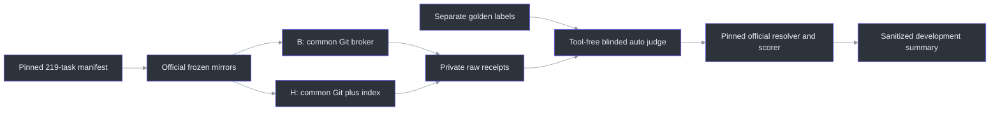
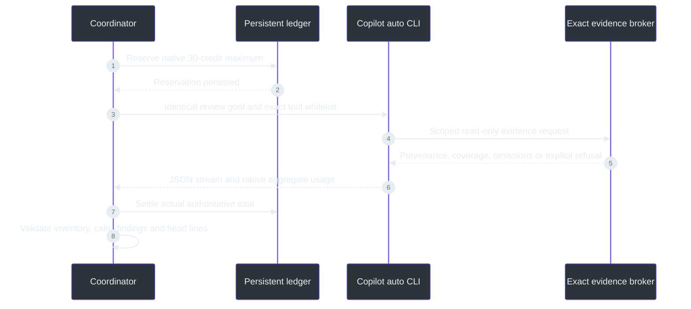

# Indexed Git versus Gita: ReviewBench

## Overview and status

This compares **the same Copilot CLI agent using `--model auto` with different
evidence tools**, not two standalone defect detectors. Auto routing can select
different realized models across arms. Results are a product-auto experiment;
they cannot establish a fixed-model causal effect.

**Implemented subset of S4, not all S4:** pinned public corpus preparation,
B/H tooling, adversarial source checks, no-retry scheduling, native accounting,
blinded research judging, and the pinned official resolver/scorer bridge.
No confirmation study, repository bootstrap/power analysis, S ablation,
full-history amortization, portal submission, or validated human-judge agreement
is implemented. The first live protocol stopped after 12 completed pairs when
a hard call-limit kill prevented native usage export. Its
[stopped-pilot projection](reviewbench-auto-pilot1-stopped.json) is retained,
including the unknown-cost session and every unfinished slot. It is not a
quality or savings result.

Execution revision v2 corrects prompt transport, denied-call finalization and
judge diff pagination. It uses a fresh protocol and run directory, not a retry
or repair of the stopped cohort. Cohorts must not be pooled.
([campaign.py:41](../../src/gita/eval/reviewbench/campaign.py),
[judge.py:1](../../src/gita/eval/reviewbench/judge.py))

## Architecture



The full public manifest is 219 tasks / 187 repositories. The official
`corpus/test/test.json` starter is 25 members of that full set, **not an untouched
test split**. Both files, scorer sources, contract, and labels are frozen at
`c17b05be9c90b85a1fc012ce39e455e2d09a7255`; labels go only to a separate
grader directory. The optional [manifest export](reviewbench-manifest.json)
contains source identities and membership, not findings or labels.
([dataset.py:14](../../src/gita/eval/reviewbench/dataset.py))

## Components and evidence contract

| Component | Enforced behavior |
| --- | --- |
| `dataset.freeze/verify` | Pin/hash public inputs, full/starter membership, official mirror URLs; separate grader labels. |
| `preparation.source_scope` | Exact supplied endpoints, independently resolved merge base, allowed parent graph, bounded history. |
| `preparation.preflight` | Independently parse changed files at both endpoints and verify returned spans against exact Git objects. |
| `Evidence` | No arbitrary repo/ref, shell, network, labels, hooks, source execution, global search, or index mutation. |
| `runtime.CreditLedger` | Persist reservations before launch; settle authoritative native totals; stop on unknown usage. |
| `campaign.run` | Frozen randomized order, one repeat, no automatic retries, independent audit and initial-pair approval gates. |
| `judge.grade` | Blinded cross-arm candidates, source-supported semantic decisions, complete classifications, exact official arithmetic. |
| `report.report` | Fixed 25-task / 50-slot denominators, unfinished/failure states, realized routes and separate judge cost. |

Sources: [evidence.py:70](../../src/gita/eval/reviewbench/evidence.py),
[preparation.py:37](../../src/gita/eval/reviewbench/preparation.py),
[runtime.py:19](../../src/gita/eval/reviewbench/runtime.py),
[report.py:10](../../src/gita/eval/reviewbench/report.py).

### Arm inventory

Both arms expose exactly the same common schemas:
`raw_diff`, `read_file`, `search`, `list_files`, `commit_log`, `file_history`.
Historical source is available at every declared allowed commit in both arms.
H additionally exposes `index_status`, `entities`, `id`, `state`, `source`,
`history`, `events`. There is no forced Gita invocation and no legacy
`gita_diff`, `gita_show`, or `gita_expand`.

Source spans include exact commit/blob/generation/context provenance.
Index sources must be previously issued complete references and are independently
checked against Git bytes. Cursors bind query arguments, revision and scope.
Raw pagination reports omissions; over-budget exact indexed source is refused,
not silently truncated. Index-build/parser gaps stay visible and retain raw
fallback. Detected source/query corruption is an integrity failure, not a
successful zero-finding review.
([evidence.py:17](../../src/gita/eval/reviewbench/evidence.py),
[preparation.py:141](../../src/gita/eval/reviewbench/preparation.py))

History starts at up to 100 prior first parents of the effective merge base,
plus the PR first-parent chain. Minimized official mirrors may provide less:
actual root/shallow bounds are recorded. Divergent PRs remain in the experiment,
with independent endpoint index contexts and raw diff fallback; cross-context
EIDs do not establish continuity and events are unavailable.

## Data flow and resource limits



CLI **1.0.97 rejects `--max-ai-credits` below 30**. Therefore the harness uses
native per-session **30**, follow-up reviewer campaign **400**, separate judge **200**,
and prospective 30-credit reservations. Do not begin a session when less than
30 credits remain. The campaign may stop before completing 25 pairs; incomplete
slots are reported rather than substituted or retried. At most two reservations
may be in flight; this implementation executes model sessions **serially**,
also avoiding concurrent paired latency measurements. Review and judging share
the **four-hour** protocol deadline, with **15-minute** sessions and **40**
evidence-call attempts. Five additional attempts/turns permit finalization only:
the broker returns a typed budget refusal without executing any new query after
40, and the audit rejects any post-budget evidence. The hard ceiling is 45
attempts/turns; missing terminal usage still stops the campaign.

The follow-up ceiling is 600 credits including judging. Earlier development
and the stopped cohort retain a conservative reviewer-cost bound of
227.8672758 credits (137.8672758 known plus 90 in unknown reservations).
Together the bounds remain below the originally authorized 750 reviewer /
200 judge limits. Missing usage is never erased or reassigned to the follow-up.
([runtime.py:19](../../src/gita/eval/reviewbench/runtime.py),
[campaign.py:206](../../src/gita/eval/reviewbench/campaign.py))

Native `totalNanoAiu` is authoritative. Per-model totals and nested agent totals
are not added to it. Input/output/cache partitions, request counts, realized
model metrics, auto routing events and missing reasoning telemetry are preserved.
Unknown usage is not zero; interrupted started slots cannot automatically run
again. Windows owned jobs kill remaining CLI/MCP descendants on close.
Exact UTF-8 prompts are supplied on stdin rather than Windows' bounded command
line. Tool-free judges use the verified nonmatching allowlist sentinel; the
unsupported `--deny-tool "*"` rule is not used. No reasoning-effort override is
sent with `auto`.

Ownership is established immediately after spawning, inside guaranteed cleanup,
before writing the process receipt. A receipt-write disk failure therefore cannot
leave the CLI or its descendants running. Provenance violations use typed
`IntegrityError`, not English-message matching; wrong generations, contexts,
returned scope and verified source invalidate the review rather than becoming
successful empty findings.
([common.py:19](../../src/gita/eval/reviewbench/common.py),
[runtime.py:320](../../src/gita/eval/reviewbench/runtime.py))

**Isolation qualification:** a bare `--available-tools` and explicit empty
argument are ignored by CLI 1.0.97 and expose 17 builtins. A fixed nonmatching
sentinel, `review-no-such-tool`, was independently observed to expose zero tools.
The judge uses that sentinel plus deny-all; reviewers use exact `review-*`
names. Every observed usage-checkpoint inventory and tool invocation is audited.
Fresh homes and disabled builtin MCP/custom instructions isolate user settings.
No assumption of safety is made from a flag alone.

Three successful parent plumbing checks cost **0.422946 credits** combined,
separate from primary review/judge campaign spend; one rejected-argument attempt
made no model call. Parent raw canary receipts remain outside the tracked source.

## Running on Windows

Run from the checkout using the requested interpreter. Outputs must remain
outside the checkout and the grader must be separate from source/review roots.
No source repository programs are executed.

```powershell
$py = 'Q:\projects\gita\.venv\Scripts\python.exe'
$env:PYTHONPATH = Join-Path $PWD 'src'
$corpus = Join-Path (Split-Path $PWD) 'reviewbench-corpus-v1'
$grader = Join-Path (Split-Path $PWD) 'reviewbench-grader-v1'
$run = Join-Path (Split-Path $PWD) 'reviewbench-run-v2'

# Public input download only; no models and no index build.
& $py -m gita.eval.reviewbench freeze --root $corpus --grader $grader `
  --manifest-export docs\benchmarks\reviewbench-manifest.json

# First wait for final production policy confirmation from the index owner.
& $py -m gita.eval.reviewbench policy-digest
# Substitute the confirmed digest, not an earlier candidate.
& $py -m gita.eval.reviewbench prepare --root $corpus --index `
  --policy-ready '<confirmed-policy-digest>' --task-limit 25
& $py -m gita.eval.reviewbench seal --root $corpus --run-root $run

# Independent harness audit must approve the printed protocol digest.
& $py -m gita.eval.reviewbench run --run-root $run --task-limit 1 `
  --audit-approval '<audited-protocol-digest>'
& $py -m gita.eval.reviewbench pair-digest --run-root $run
# Inspect BOTH initial raw bundles, then explicitly approve their receipt digest.
& $py -m gita.eval.reviewbench run --run-root $run --task-limit 25 `
  --audit-approval '<audited-protocol-digest>' `
  --pilot-approval '<inspected-initial-pair-digest>'

& $py -m gita.eval.reviewbench grade --root $corpus --run-root $run --grader $grader
& $py -m gita.eval.reviewbench report --run-root $run
```

`freeze` is single-publication; reuse via `prepare/seal` verifies the existing
freeze. Changes to harness/product/parser/scopes force a new protocol/run root.
Do not reissue `run` to recover an interrupted started slot. There are no
automatic repeats or success-assisted replacements.
An integrity stop is terminal in the persistent ledger even after credits settle.
Every reservation rechecks prior receipts; restarting `run`, deleting a derived
summary, or repeating the approval string cannot clear the stop. Judging is also
blocked. Protocols are bound to the run-root digest, so copying one to a fresh
directory requires resealing and independently approving a new protocol.
([__main__.py:15](../../src/gita/eval/reviewbench/__main__.py),
[campaign.py:188](../../src/gita/eval/reviewbench/campaign.py))

## Quality scoring and limits

The output name is **blinded-auto-reference-agreement (pinned official
resolver/scorer)**, never an official score or leaderboard comparison.

The official TS resolver/scorer executes unchanged through Node 22.19+'s native
type stripping, with no npm installation or lexical/mock scoring fallback.
Conformance cases include many-to-many edges, duplicate precision claims,
known FP, novel TP, null denominators, stratification and candidate ordering.
The resolver may assign precision credit to one golden while covering multiple
goldens; this is not a maximum one-to-one matcher.
([score_bridge.mjs:1](../../src/gita/eval/reviewbench/score_bridge.mjs),
[test_reviewbench_scorer.py:1](../../tests/test_reviewbench_scorer.py))

**Material deviations:** the semantic matcher and classifier are custom,
tool-free Copilot auto sessions, not the pinned hosted provider/session prompts.
They receive fixed endpoint snippets and raw diff, not interactive related-code
tools, builds or future fixes. Raw diff continuations are followed to completion;
the total serialized source context must remain within 180,000 characters.
Oversized or missing context leaves judging pending, never silently truncated.
Uncertain, malformed, missing or duplicate judgment rows block scoring;
unmatched candidates need exactly one terminal TP/FP classification.
All raw correspondence edges, classifier evidence and the private blinding map
are retained. Human source-supported audit remains required before efficacy
claims. Automatic novel TP/FP classification is not verified defect precision.
([judge.py:19](../../src/gita/eval/reviewbench/judge.py))

## Offline validation and raw artifacts

```powershell
$env:REVIEWBENCH_FROZEN_ROOT = $corpus
$tests = @(Get-ChildItem tests\test_reviewbench*.py | ForEach-Object FullName)
& $py -m pytest @tests tests\test_objects.py -q `
  --basetemp C:\gita-reviewbench-test-workspaces
```

Tests perform **no paid/model calls**. Synthetic Git fixtures exercise future
objects, wrong revisions/graphs, cursor/source tamper, independently wrong query
results, common-tool parity, output coordinates, multi-route usage/double counting,
credits, owned process cleanup, strict resumes, real MCP stdio and scorer conformance.
Without a provisioned official scorer root, conformance is explicitly skipped:
that skip is not permission to publish scientific results.

Follow-up qualification: **172 tests passed** (94 evaluator and 78 Git-object
tests), including actual MCP stdio,
owned Windows process cleanup, independently reparsed indexed evidence and
executed pinned official TypeScript conformance, exact long UTF-8 stdin delivery,
post-budget query denial, completion correlation, and complete/cyclic diff
pagination. These tests make no paid calls. CI runs the evaluator offline;
pinned scorer conformance requires the explicitly provisioned public corpus.

The auditor regressions were first reproduced red: wrong generation/context
were ordinary refusals, a restarted settled integrity failure launched another
attempt, and a process-receipt write failure escaped cleanup. Green regressions
now prove typed terminal failures, sticky stops across repeated invocation and
fresh-root copying, cross-reviewer/judge stop propagation, and actual owned-parent/descendant reaping
after an injected disk failure. Every live protocol still needs an exact
preflight/audit approval and an inspected first-pair receipt before continuation.

Actual preparation now creates normal `.git` repositories, fetches exact objects,
and points HEAD at the task head **without checking out or executing corpus files**.
This avoids the production `safe.bareRepository=explicit` restriction without
weakening it. A network-free integration regression exercises actual preparation,
index publication, query, and cached-future exclusion; earlier nonbare-only unit
fixtures did not cover this preparation bug. Seals also record the current source
Git HEAD alongside source/harness hashes.

Private artifacts include `protocol.json`, `scopes.json`, persistent ledgers,
`attempts\...\started.json`, command/prompt receipts, `events.jsonl`, `stderr.txt`,
`usage.json`, broker call logs, validated findings and terminal results.
Grader-only artifacts include labels, fixed judge inputs, raw judge traces,
correspondences, classifications and blinding maps. Only the small
`sanitized-results.json` projection is suitable for a tracked report; do not
publish encrypted API-call IDs, credentials, user configuration paths or source dumps.

## References

- [S4 target protocol](../projects/index-first/04-review-evaluation.md)
- [Pinned official agent contract](https://github.com/review-bench/ReviewBench/blob/c17b05be9c90b85a1fc012ce39e455e2d09a7255/AGENT_CONTRACT.md)
- [Pinned official precision resolver](https://github.com/review-bench/ReviewBench/blob/c17b05be9c90b85a1fc012ce39e455e2d09a7255/scripts/lib/match-types.ts)
- [Harness package](../../src/gita/eval/reviewbench/)
