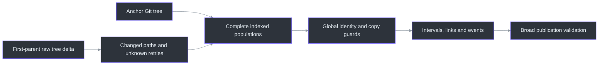
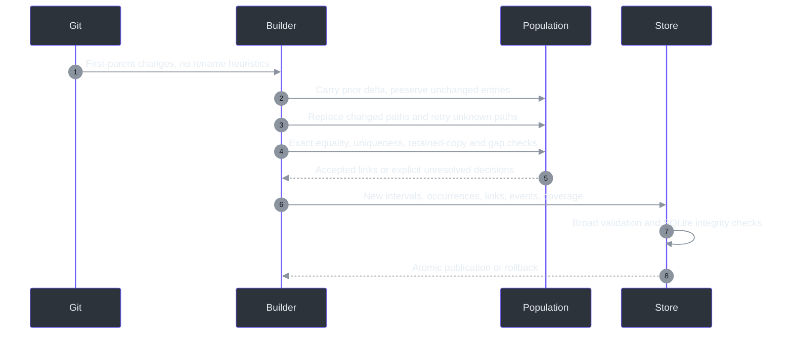

# Delta indexing performance and remaining scale costs

## Overview

An unchanged file must remain part of global uniqueness and retained-copy checks,
but it need not be enumerated, inserted into two temporary populations, or have
its match flags reset at every commit. The builder now keeps complete indexed
before/after populations for one build transaction and advances them by changed
Git tree entries. This is an indexing change, not a smaller token cache presented
as incremental indexing. (`src/gita/index/builder.py:609`, `_carry_population`;
`src/gita/index/builder.py:624`, `_inventory`)

This does **not** make reopening and appending a generation proportional only to
changed files. Rehydrating complete lookup metadata from the persisted frontier,
copying the predecessor checkpoint, and broad publication validation still cost
work proportional to retained evidence. (`src/gita/index/builder.py:420`, `_Builder.__init__`;
`src/gita/index/store.py:841`, `begin_generation`; `src/gita/index/store.py:1401`, `publish_generation`)

## Architecture



| Component | What changed | What remains authoritative |
|---|---|---|
| Git inventory | Full enumeration at the anchor; raw first-parent deltas thereafter | Literal path bytes, qualified object IDs, modes and object types |
| Transaction populations | Carry only previous changed paths; replace only current changed paths | Both complete populations remain available for every global lookup |
| Unknown entries | Retry from retained entry metadata without enumerating complete files | Existing explicit extraction and cached-source coverage records |
| Immutable decoding | Bounded 32 MiB / 4,096-entry cache | Every read fetches and compares **all** stored columns before reuse |
| Unsupported extensions | Classify using object metadata without reading/dispatching blob contents | Explicit unsupported coverage; no implied complete source coverage |

Sources: `src/gita/vcs/git.py:906`, `tree_changes`;
`src/gita/index/builder.py:624`, `_inventory`; `src/gita/index/builder.py:718`, `_count`;
`src/gita/index/builder.py:805`, `_copy_guard`; `src/gita/index/store.py:230`, `_DecodedRecords`.

Tree IDs come from already validated persisted commit metadata. The append path
does not reread the published parent's commit through the object API. Git itself
still needs the old tree objects for its raw diff. The existing forbidden-prefix-
read and missing-cached-blob contracts pass with this path.
(`src/gita/index/builder.py:630`; `src/gita/vcs/git.py:906`;
`tests/test_index_builder.py:3575`)

## Data flow and identity safety



Global counts still query the complete compatible population, not only the edited
files. A copied function does not inherit the unchanged original's EID; competing
matches, parse gaps and candidate limits retain their existing refusal and
coverage behavior. Similarity remains a candidate signal and cannot establish
identity. (`src/gita/index/builder.py:_count`, `_copy_guard`, `_gap`, `_suggestions`;
`src/gita/index/matching.py:classify_transition`; `src/gita/index/model.py:LineageLink`)

Publication retains membership, interval continuity, frontier equality,
coverage, duplicate-active-EID, seed, lineage-gap, departure, link and event
checks, plus SQLite structural/foreign-key checks. None was disabled for speed.
(`src/gita/index/store.py:publish_generation`, `check_integrity`)

## Rust module contract

The old Rust adapter produced non-synthetic `module` definitions for real `mod`
declarations; accepted transition classification correctly refused those records
with `only synthetic roots have module kind`. The byte evidence producer now maps
named module bindings to `namespace`. Inline modules still own their exact spans
and children; out-of-line declarations remain declarations, not inferred content
from another file. Only the synthetic file root has `module` kind.
(`src/gita/index/evidence.py:_build`; `src/gita/index/matching.py:classify_transition`;
`tests/test_index_delta.py:test_rust_named_modules_are_namespaces_not_synthetic_file_roots`)

The pinned failure is reproduced on ripgrep anchor
`626b8951acbced7ff710f4e01624a05f219eec38`, 20-commit tip
`5055264ae021b5d0e01e55f723622d638ea877f0`
(retained source tip `3fce3b5bb0236da2df6d99672afb8a719642eca7`).
Before/after receipts remain in
`verify/results/scale-20261015/{baseline,candidate}-public/ripgrep-history/`.

## Interpretation and rebuild requirements

Schema version 2 and its durability contract are unchanged. Existing stores are
not migrated or deleted. Parser fingerprints include adapter source, and match
fingerprints include builder source, so an existing publication under the old
policy must refuse append with `rebuild_required`. Use an explicit rebuild after
changing the interpretation; do not bypass fingerprint checks.
(`src/gita/index/evidence.py:156`, `parse_fingerprint`;
`src/gita/index/matching.py:151`, `match_manifest`;
`src/gita/index/builder.py:build`; `src/gita/index/store.py:open`)

Frozen candidate:

| Fingerprint | Value |
|---|---|
| Parser | `884168068efce3b9e5bb1da3d172cc5024933143db9f766f437953fe26148120` |
| Builder SHA-256 | `dc70a75fd7e281e7e6bb977b8cdea3b8aa5dee7eff0e78bcb8033e77c7971689` |
| Match, 64 candidates / 10,000 pairs | `ec9c5e1ca9148a6bd6b3ae091613b4c44987fb03bebea381ded98df6fc3d5f45` |
| Store SHA-256, final overlap proof | `5c079d61d45c3eb45b86b744ad8156a0ec167c43fe6cac70983ae9fc36d00c39` |
| Index runtime SHA-256 | `8be20d1030cd0aa7cedf827ac3b7a36f96095f975e7092a50f7325eafbc46067` |

The store-only publication optimization below is mathematically equivalent
validation, not a new parse or identity interpretation. Its source hash changes,
but the parser/match fingerprints and schema remain compatible with already
validated stores; no reinterpretation or migration is performed.
(`src/gita/index/store.py:_overlapping_eid`)
The index-runtime digest hashes sorted `src/gita/index/*.py` plus
`src/gita/vcs/git.py`, using each path relative to `src`, a NUL separator, and
file bytes. Exact freeze metadata is retained in `final-runtime.json`.

## Measurements

The publication-ready, path-redacted
[machine-readable evidence summary](benchmarks/index-delta-performance-summary.json)
is intended to be tracked with this report. It is exported from the actual final
receipts and includes exact baseline/corpus pins, runtime hashes, scenario timings,
row/parse counters, sampled resource measurements, exclusions, parity outcomes,
and hashes of the local receipts. It is indexing evidence, not ReviewBench review
quality or a replacement for an independent lineage oracle.

**Raw artifacts are local and not distributed.** The ignored
`verify/results/scale-20261015/` directory retains raw requests, complete receipts,
SQLite stores, profiles, fixture repositories and frozen source archives for
local audit/reproduction. Their machine-specific paths and bulky contents are
deliberately absent from the summary. Receipt hashes establish provenance but do
not make the unpublished raw artifacts independently downloadable.

The baseline is the isolated `bcab3c1` worktree, not an earlier unrelated release.
Both versions use the retained Flask/Express exact 20-commit scopes, the same
installed Python/grammars, four parse workers, fresh stores for cold scenarios,
and no execution of corpus code. RSS is sampled across owned child process trees;
shared pages can be counted more than once. OS/Git caches, host contention and
power policy are uncontrolled. These are single-run observations, not universal
throughput claims. (`verify/profile_index_scale.py`; `verify/bench_public_index.py:execute`;
`verify/public_index_worker.py:profile_build`, `run`)

Hardware: Windows AMD64 VM reporting AMD EPYC 7763 64-Core Processor, 8 virtual
cores / 16 logical processors, 63.95 GiB RAM; Python 3.11.9, SQLite 3.45.1.
Exact receipts, profiles and
hardware metadata are retained under `verify/results/scale-20261015/`.

### Initial profile and reproducible correction

The first candidate profile below used builder SHA-256 `7e4b10...`. Full core
tests subsequently exposed three append-prefix-read regressions; those were
fixed using the persisted-tree diff path before the final-policy qualification.
The profile is retained as investigation evidence, not mislabeled as a final
runtime receipt.

| Flask, 20 commits | Baseline | Candidate |
|---|---:|---:|
| Build seconds, **cProfile enabled** | 149.247 | 73.004 |
| Inventory / parse / persist phase seconds | 20.207 | 15.839 |
| Candidate matching phase seconds | 60.151 | 11.589 |
| Full tree enumerations | 20 | 1 |
| Full tree entries yielded | 4,720 | 236 |
| Raw first-parent delta entries yielded | 0 | 62 |
| Candidate pairs considered | 77,764 | 77,764 |
| Parsed / cached file outcomes | 298 / 2,492 | 298 / 2,492 |

The phase reduction combines actual population/inventory delta work with bounded,
column-compared immutable decoding; it must not all be attributed to the tree
delta. cProfile materially inflates these wall times. Production wall timings
and larger generated workload results are reported separately below.

Cross-policy comparison after the append proves equal versions, definitions,
occurrences, lineage seeds, links, events, file intervals, coverage and departures
for Flask and Express. Interpretation-derived IDs are intentionally different;
the comparison maps lineage to exact seed occurrence/reason rather than pretending
old and new EIDs are interchangeable. This is equivalence evidence, not an
independent real-repository lineage oracle.
(`verify/compare_delta_evidence.py:facts`; `verify/results/scale-20261015/flask-cross-policy.json`;
`verify/results/scale-20261015/express-cross-policy.json`)
The final store-SQL candidate repeats that parity successfully in
`publication-final-flask-parity.json`, `publication-final-express-parity.json`,
and `reopen-sql-fix-parity.json`. The last compares all nine fact categories for
the same 10,000-file checkpoint and exact append commit, including 20,042
definitions and 10,021 file intervals.

The original 256 MiB ripgrep history run now gets past the Rust contract but
correctly refuses a 330,656,648-byte commit storage reservation. That failed
attempt is retained; the separate final qualification uses a **new owned store**
with an explicit 512 MiB bound, not a bypass of the storage check or invalidation
of a retained store. (`verify/results/scale-20261015/candidate-public/ripgrep-history/history.json`;
`src/gita/index/store.py:1569`, `check_storage_limit`)

### Production wall timing and generated scale

Final receipts are recorded in `baseline-public-unprofiled`,
`publication-final-public`, `baseline-generated` and `publication-final-generated`.
The generated corpus has one distinct Python function per file and 21 pinned
commits: an anchor and twenty one-file edits. It tests 100 / 1,000 / 10,000 files
and functions, not merely 10,000 functions in a tiny inventory.
(`verify/bench_delta_scale.py:corpus`, `main`)

The edited function's increasing constant coincides with a retained function's
body. Consequently these history cases also exercise conservative retained-copy
refusals and bounded candidate searches. They are not claimed as ordinary
nonduplicating one-file edit latency. (`verify/bench_delta_scale.py:source`;
`src/gita/index/builder.py:805`, `_copy_guard`)

| Public corpus, seconds | Baseline `bcab3c1` | Final |
|---|---:|---:|
| Flask snapshot | 10.513 | 9.312 |
| Flask 20-commit history | 73.057 | 39.423 |
| Flask reopened append | 12.948 | 7.342 |
| Express snapshot | 16.590 | 16.437 |
| Express 20-commit history | 65.981 | 42.592 |
| Express reopened append | 19.061 | 12.963 |
| Rust snapshot, explicit 512 MiB bound | Baseline snapshot passed; history failed its module contract | 21.865 |
| Rust pinned 20-commit history, 512 MiB | `invalid_record` | 122.363 |
| Rust reopened append / no-op, 512 MiB | Not available | 15.819 / 0.382 |

The snapshots remain **partial**, with unchanged exclusions: Flask 104 complete
and 132 unsupported parse results; Express 153 complete and 61 unsupported.
Rust has 152 complete, 84 unsupported, and one non-source object. Classification
without reading unsupported blob contents does not turn those files into indexed
source. Native `.c`, `.cu`, and `.pyx` paths currently have no registered byte
adapter; `.cpp` does. This study does not qualify NumPy or PyTorch coverage.
(`src/gita/index/evidence.py:_spec_for_path`;
`verify/results/scale-20261015/publication-final-public`;
`verify/results/scale-20261015/publication-final-rust`)

| Files / functions | Scenario, seconds | Baseline | Final |
|---:|---|---:|---:|
| 100 | Snapshot / history / append | 2.556 / 5.973 / 1.783 | 2.941 / 4.769 / 1.514 |
| 1,000 | Snapshot / history / append | 13.511 / 18.403 / 4.231 | 9.186 / 12.568 / 2.802 |
| 10,000 | Snapshot | 234.471 | 100.506 |
| 10,000 | 20-commit history | 322.139 | 147.193 |
| 10,000 | Reopened one-file append | 127.631 | 23.453 |
| 10,000 | No-op | 0.345 | 0.395 |

Small snapshots and no-ops can regress under shared-host contention; these are
not averaged, cache-controlled measurements. All final scenarios completed
within the 600-second child bound, with owned child cleanup checked.

### Removing the reopened publication cross product

The first delta candidate still took 137.089 seconds for a reopened 10,000-file
append, versus 127.631 baseline. That was a regression, not a completed scalable
milestone. A separate **same-commit, same-checkpoint** profile isolated the cause:

| Exact 10,000-file append | Before overlap fix | After overlap fix |
|---|---:|---:|
| Production wall seconds | 120.782 | 21.115 |
| Profiled build seconds | 144.497 | 41.589 |
| Profiled checkpoint copying | 0.804 | 0.787 |
| Profiled frontier hydration | 20.481 | 20.677 |
| Profiled publication validation | 116.569 | 13.428 |

SQLite planned the old duplicate-active-EID guard as an earlier-generation
interval scan multiplied by a later-generation interval scan. The final proof
sorts presence by EID/start and compares each start against the **maximum of all
prior ends**. For nonempty half-open intervals this detects every overlap,
including nested intervals and open-ended presence. A simple `LAG` would not be
equivalent. Validated membership count supplies the finite end of open intervals.
Other publication checks remain in place.
(`src/gita/index/store.py:_overlapping_eid`, `publish_generation`;
`tests/test_index_delta.py:test_publication_overlap_guard_matches_independent_interval_math`)

At 512 distinct active EIDs, the old query executed approximately 3,406,900
SQLite VM instructions; the final proof uses 32,800. The deterministic VM-budget
test was red before the fix and green after it, alongside randomized independent
interval-math checks. (`tests/test_index_delta.py:test_publication_overlap_guard_has_subquadratic_vm_work`;
`test_publication_overlap_guard_randomized_math_parity`)

The old runtime source is retained under `reopen-before/runtime-src`; the exact
append commit is reused for `reopen-after` and the unprofiled
`reopen-before-wall` / `reopen-after-wall` runs. No retained user store was
modified or reinterpreted for this comparison.
(`verify/profile_reopen.py`)

## Correctness and constrained test receipts

* Before the final, store-only overlap change: **738 core/Git tests passed**,
  with 27 harness/legacy cases separately identified.
* After that change: **342 storage/new-regression tests passed**, including
  interval overlaps, immutable storage, publication, corruption and durability
  contracts. The final combined core/Git rerun completed **746 passed / 27
  separately identified harness/legacy cases deselected**, using a short owned
  fixture path, in 811.84 seconds. Receipt: `publication-short-core.log`.
* The exact 27-case cohort was actually rerun: **18 failed, 9 passed** with the
  original long fixture paths and legacy disabled. Four failures exercise
  explicitly retired legacy diff operations; 14 checkpoint failures were
  diagnosed as Windows Git `.git/objects/...: Filename too long`. They were not
  silently relabeled as passes or missing-source exceptions.
* Short owned fixture paths fix that path-length problem: the 73 Git object tests
  pass, and the exact 27-case cohort rerun finishes **23 passed / 4 failed**.
  All four remaining failures assert behavior of explicitly disabled legacy
  diff operations. The receipt is `short-harness.log`; legacy was not enabled
  to manufacture a green result.
* The parent separately ran those exact four
  `TestIndexedDiffRefusesRatherThanGuesses` cases under the intended, explicitly
  gated `GITA_ENABLE_LEGACY=1` CI compatibility mode with short fixture paths:
  **4 passed in 7.86 seconds**. This verifies the opt-in compatibility contract,
  not the default-disabled behavior. Both outcomes are retained in the sanitized
  summary. The opt-in result is identified as parent-reported execution; its raw
  receipt was not supplied to this exporter, so no receipt hash is invented.
* Two additional benchmark/campaign harness tests refuse output inside the
  source checkout under this task's write-location restriction. Their refusal
  receipts remain in `benchmark-tests.log`; no safety check was bypassed.

Exact names are retained in `exact-deselections.txt`, and original failures in
`frozen-core.log`, `constrained-harness.log`, and `publication-final-core.log`.
No full-suite-all-green claim is made from a selected cohort. No further
production edits are made during qualification or ReviewBench precompute.

## Remaining costs and realistic scope

* Cold indexing still visits every file and parses every supported source blob.
* Append in a new process still hydrates complete lookup metadata once. Persistent
  frontier membership is not a persistent representation/count index.
* Immutable checkpoint continuation still copies retained predecessor rows.
* Publication still validates broad retained populations and database integrity,
  but its active-EID overlap proof no longer performs an interval cross product.
* Unknown-file retries remain proportional to unknown entries; unsupported
  extensions still have explicit coverage rather than disappearing from reports.
* Similarity proposals remain bounded, but building their complete source search
  and exact payload comparisons is not constant time.
* Temporary SQL populations and representation metadata can grow with retained
  history. Disk-spill bytes are not portably measured by the supervisor.

These costs follow the current schema and preserve its correctness guarantees.
The generated 10,000-file measurements are a scaling observation, not NumPy or
PyTorch qualification. Those projects require actual snapshots and bounded
history runs with their mixed-language/file-size distributions; no such
production readiness claim is made here.
(`src/gita/index/builder.py:_Builder.__init__`, `_metadata`, `_suggestions`;
`src/gita/index/store.py:begin_generation`, `publish_generation`, `_configure`)

## Reproduction and references

Run from the checkout using its supported Python environment:

```powershell
python verify\profile_index_scale.py --source src --output <new-output-directory> --retained <retained-corpora-parent> --unprofiled
python verify\bench_delta_scale.py --source src --output <new-output-directory> --corpora <generated-corpora-directory> --sizes 100 1000 10000
python -m pytest tests\test_index_delta.py tests\test_index_builder.py tests\test_index_store.py tests\test_index_query.py
```

Output directories must be new. Existing corpus stores are never reused or
invalidated by the runners. Full core correctness results, workload pins,
profiles and supervised process cleanup receipts are retained with the study.
(`verify/profile_index_scale.py:main`; `verify/bench_delta_scale.py:main`)
